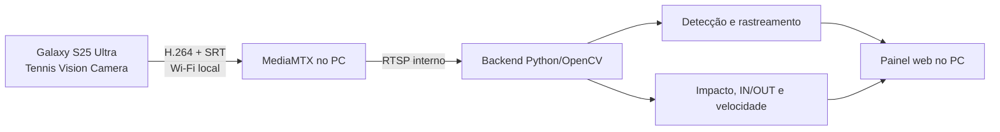

# Arquitetura do aplicativo de câmera

## Objetivo

Retirar a dependência do Larix e manter a análise no computador, onde há mais CPU/GPU, armazenamento e espaço para o painel completo. O celular funciona como câmera especializada; o PC recebe, analisa e apresenta os resultados.



## Responsabilidade de cada aparelho

### No celular

- câmera traseira por Camera2, com sessões comuns de 30/60 fps ou de alta velocidade em 120/240 fps quando compatíveis;
- codificação H.264 por hardware;
- transmissão SRT de baixa latência;
- leitura do QR de pareamento;
- indicação separada de FPS capturados, codificados e enviados, além de bitrate e descartes;
- reconexão quando o Wi-Fi oscilar.

### No computador

- MediaMTX recebe cada câmera;
- OpenCV e os modelos de IA analisam o frame mais recente;
- duas câmeras podem alimentar a mesma sessão;
- painel exibe vídeo anotado, trajetória, impactos, velocidade, IN/OUT, mapa e estatísticas;
- gravações, calibrações e perfis continuam salvos no PC.

## Pareamento

O painel também fornece o APK em `/api/mobile-camera/android.apk` e informa versão e disponibilidade em `/api/mobile-camera`. O arquivo compilado acompanha o projeto em `mobile/releases`.

O endpoint `/api/mobile-camera` cria um URI local semelhante a:

```text
tennisvision://pair?host=192.168.15.2&port=8890&path=galaxy&transport=srt&fps=60&width=1920&height=1080&bitrate=12000000&latency=40
```

O QR contém somente configuração de rede e vídeo. Ele não contém senha da câmera. O app valida host, porta e caminho, e cria a publicação:

```text
srt://192.168.15.2:8890?streamid=publish:galaxy&latency=40&pkt_size=1316
```

O perfil inicial do QR é 1080p60. Para 120/240 fps, o usuário escolhe **Qualidade** no app após parear. O cadastro de câmera aceita até 240 fps, mas o receptor usa a taxa real da fonte; esse campo não limita o MediaMTX.

## Captura de alta velocidade na versão 0.3.0

`CameraCapabilities` cruza as faixas fixas e resoluções de alta velocidade de cada câmera traseira com o suporte do codificador H.264 por hardware. `CameraSession` cria uma sessão `CONSTRAINED_HIGH_SPEED`, com prévia e encoder do mesmo tamanho, e envia a lista de solicitações com `setRepeatingBurst`. `NativeCameraStream` liga a superfície da câmera diretamente ao `MediaCodec` e usa os timestamps dos buffers na publicação SRT.

A prévia pode rodar a 30/60 fps enquanto a saída para codificação recebe a taxa maior. O Android impõe foco e exposição automáticos neste modo. Os controles manuais ficam disponíveis somente nas sessões comuns. As medições usam timestamps de captura e contagens reais de frames do encoder e da rede; o número solicitado no perfil não é usado como FPS medido.

A taxa sustentada de 120/240 fps no S25 Ultra ainda precisa de teste físico. O suporte anunciado pelo Camera2 e pelo codec é um filtro de compatibilidade, não uma medição de desempenho. A análise e o painel podem trabalhar abaixo da taxa capturada para manter baixa latência.

## Latência

O caminho SRT solicita buffer de 40 ms como ponto inicial. A latência negociada depende também do receptor. O atraso total inclui exposição, codificação, Wi-Fi, decodificação e análise. O backend continua descartando frames antigos e processando o mais recente para impedir que atrasos virem uma fila crescente.

`TransportProfile` define Mínimo atraso (40 ms SRT/80 ms fila), Equilibrado (80/150 ms) e Mais tolerante (160/250 ms). A fila usa frames inteiros, com mínimo de três, e o bitrate varia entre metade e o máximo do perfil. Após descarte ou acúmulo, `KeyframeRecovery` aguarda uma referência AVC nova; o descarte de cache e a liberação do quadro são sincronizados para evitar retomar com um frame que dependia do cache descartado. Há intervalo mínimo de 1,5 s entre retomadas.

Nos modos comuns, a exposição curta permite solicitar 1/1000, 1/2000 ou 1/4000 s dentro do suporte do sensor. A interface mostra o resultado real, não somente a solicitação. Lanterna e zoom usam controles comuns às sessões; foco e exposição manuais ficam desabilitados em alta velocidade. O foco por toque considera o recorte da câmera e a proporção do vídeo. O zoom só pode ser ajustado antes da transmissão e exige conferir a área marcada no PC.

## Detector e visualização na versão 0.4

O detector usa a imagem reduzida para localizar movimento. Componentes verdes muito pequenos apontam até quatro recortes da imagem original, sem depender de uma trajetória existente. Uma bola com contorno já claro perto da trajetória dispensa essa busca adicional. Os candidatos ainda passam pelas regras de fundo, corpo, geometria e aparência; não entram diretamente nas estatísticas de impacto.

Propostas alongadas usam dois recortes para a rede de aparência: o contexto original de treinamento e uma porção central que preserve o núcleo verde. O rastreador e o detector de impacto mantêm suas verificações temporais. Testes controlados cobrem aquisição de bolas de 8–12 pixels movendo 80 pixels por frame e rejeição de um ponto verde parado quando uma mão se move ao lado.

O WebRTC exibe o H.264 original. O JPEG alternativo é comprimido somente sob demanda, em até `TV_PREVIEW_MAX_FPS` (60 por padrão). Depois de aguardar o orçamento de compressão, o worker busca o frame mais recente; ele não segura o frame antigo durante a espera. A captura não espera esse worker. Recepção, análise e exibição continuam com taxas independentes.

No trecho de 300 frames do replay de 18/09, ficaram 207 observações e 15 candidatos a impacto. Esse replay não tem referência independente para afirmar precisão ou que todos os contatos foram encontrados. A captura e a transmissão no S25 ainda precisam de validação física.

## Revisão de erros na versão 0.4.1

- Android: compensação de ISO nas duas direções ao trocar o obturador, controles de acordo com o sensor selecionado, descarte de callbacks antigos e quadro-chave novo após conectar ao receptor. O encerramento tenta liberar câmera, conexão e codec mesmo quando uma etapa falha.
- Vídeo: a imagem JPEG original tem cache separado da prévia reduzida. Os metadados do vídeo sincronizado preservam a resolução do quadro codificado. Valores inválidos nas opções da prévia voltam ao padrão. O painel monitora a reprodução real do H.264 e usa a prévia JPEG se o WebRTC não abrir ou parar de produzir quadros.
- Calibração: o modal usa o quadro original e permite escolher a câmera. O backend valida os pontos de conferência e serializa alterações do perfil para não sobrescrever outra configuração simultânea.
- Detecção: a posição atual da pessoa permanece disponível entre inferências YOLO; o cache antigo tem prazo limitado. Isso mantém a exclusão de corpo e mãos nos frames em que o modelo de bola não executa.
- Sessões e replays: falhar ao iniciar ou encerrar uma câmera não impede a limpeza da outra. Replays ausentes ou corrompidos retornam uma mensagem útil, e o player não reutiliza quadros de outro replay nem permite índices negativos quando está vazio.
- Som OUT: o carregamento é compartilhado entre cliques e volta a tentar depois de falha no download ou na decodificação.

Validação de software: 179 testes Python, 19 testes Android, 8 testes Node, `assembleDebug`, `lintDebug`, verificação TypeScript e compilação de produção do painel. O teste no navegador usa duas fontes RTSP sintéticas isoladas para conferir reprodução H.264, calibrações independentes, área persistida e recuperação para JPEG; esses dados não entram nas sessões do usuário e não medem precisão de bola ou atraso do celular.

O teste físico de câmera, exposição, foco, Wi-Fi e 120/240 fps continua pendente porque nenhum aparelho foi encontrado por ADB nesta revisão.

## Próximas verificações e evolução

1. Medir captura, H.264, envio, perdas e temperatura no S25 Ultra em 60/120/240 fps.
2. Medir recepção, análise e atraso no PC com uma ou duas câmeras.
3. Aplicativo iOS em Swift/AVFoundation no caminho `/iphone`.
4. Sincronização temporal de duas câmeras para melhorar a posição do impacto.


## Correções Android 0.5.2

O aplicativo detecta quando o codificador H.264 deixa de produzir vídeo, mesmo que os callbacks da câmera continuem. Depois de uma falha de rede/autenticação, a prévia local pode ser reaberta sem manter a última imagem congelada. Parar a transmissão mostra o estado de espera até haver uma imagem nova. Falhas reais da captura não disparam reaberturas em ciclo.

Validação: 47 testes JVM/Robolectric, Android Lint e APK release compilados. O Studio 0.6.1 inclui este APK, com o mesmo certificado local das versões anteriores. Sem dispositivo no ADB, os modos físicos 120/240 fps continuam pendentes de medição. A revisão completa está em [app-audit-2026-10-02.md](app-audit-2026-10-02.md).

## Correções Android 0.5.1

- Leitor de QR próprio com ZXing incluído no APK. Instalação manual e leitura não dependem de Google Play Services ou de baixar o módulo `barcode_ui`. A câmera é liberada antes de abrir o leitor; cancelar restaura os controles sem apagar o pareamento.
- Selecionar 120/240 fps mantém uma prévia comum em até 60 fps. Ao transmitir, o app configura uma sessão de alta velocidade com duas superfícies da mesma resolução e a faixa fixa anunciada pelo aparelho. O vídeo gravado/enviado continua solicitando a taxa escolhida; a prévia da tela pode rodar a 30/60 fps.
- O H.264 verifica resolução, taxa e bitrate para cada perfil/nível anunciado. Baseline deixa de ser forçado quando somente outro perfil aceita a captura rápida.
- Trocas de perfil e abertura do leitor aguardam `CameraDevice.onClosed` fora da interface. A conexão SRT começa após a sessão de captura estar configurada; um callback atrasado não reconecta uma transmissão já encerrada.
- Zoom, lanterna e ajustes manuais ficam desabilitados em alta velocidade para evitar solicitações extras incompatíveis.

Validação desta correção: 45 testes JVM/Android simulado, incluindo decodificação de QR gerado, abertura/cancelamento/resultado do leitor, permissões, regras de sessões, limites da resolução da prévia e tabelas AVC reais do framework Android. APK `release` e análise estática compilados sem erros. Nenhum S25 foi encontrado por ADB; o desempenho da câmera e a transmissão em 120/240 fps ainda precisam ser medidos no aparelho físico. O APK 0.5.1 atualiza as versões anteriores com o mesmo certificado local e usa o protocolo do Studio existente.

Referências da implementação: [sessões Camera2 de alta velocidade](https://developer.android.com/reference/android/hardware/camera2/CameraConstrainedHighSpeedCaptureSession), [módulo do leitor Google](https://developers.google.com/ml-kit/vision/barcode-scanning/code-scanner), [ZXing Android Embedded](https://github.com/journeyapps/zxing-android-embedded).

## Revisão Android 0.5.0

A interface Android usa a identidade visual do Tennis Vision Studio: tons de grafite, verde, prévia ampla, pareamento por QR, configuração manual recolhível e três abas. Em telas mais baixas o cabeçalho é compacto para manter o QR e o botão principal acessíveis. Tela cheia mantém a transmissão e responde ao botão Voltar. Os valores de captura, H.264 e envio são medidos e ficam separados do FPS solicitado.

Correções desta revisão:

- A concessão de câmera continua uma solicitação de transmissão pendente, sem abrir pedidos duplicados de permissão. O app oferece acesso às configurações quando a câmera está bloqueada.
- O perfil do novo QR é salvo diretamente. Quando a resolução/FPS não existe no aparelho, o app escolhe uma combinação disponível e informa a adaptação. Ele não inventa taxas de captura.
- Qualidade, obturador, guia e aba/tela cheia sobrevivem ao ciclo previsto de fechamento ou recriação. Luz e foco travado não reutilizam uma distância antiga ao reabrir a câmera.
- Cada cliente SRT tem um identificador de ciclo. Mensagens de uma conexão encerrada não alteram a conexão seguinte. Reconectar pede um quadro-chave novo, e a fila continua limitada por duração.
- Fechar câmera e codec ocorre fora da thread da interface. O app libera o bloqueio temporário de Wi-Fi nos caminhos de parada e encerramento. A perda da rede ativa aciona a recuperação.
- Ajustes Camera2 pendentes são descartados quando pertencem a outra câmera/sessão. A prévia oferece feedback breve do foco e ação de foco central para acessibilidade.
- Uma fonte que deixa de produzir frames é indicada como falha, em vez de conservar FPS antigos. O aplicativo reduz atividade de telemetria quando está fora de primeiro plano.

O APK distribuído é a variante `release`, com recursos/código otimizados e o certificado local já usado nos APKs anteriores, para permitir atualização. O certificado de desenvolvimento não deve ser usado para publicar na Play Store; uma publicação exige configuração própria de assinatura protegida. A chave privada não acompanha o pacote de código.

Validação: testes JVM de fluxo, perfis, FPS, exposição, fila e descarte de callbacks; renderização das próprias views Android em janela larga, compacta e retrato; compilação da variante de instalação e Android Lint. Os testes instrumentados de interface também acompanham o código para executar em um dispositivo Android. A renderização de teste não contém vídeo ou medições simuladas de uma câmera real.

Limite da revisão: nenhum Galaxy foi encontrado por ADB. A sustentação de FPS altos, qualidade da imagem em movimento, foco, aquecimento e atraso de rede ainda precisam de medição no aparelho físico. O novo APK funciona com o protocolo SRT do Studio existente. A distribuição Windows 0.5.0 anterior mantém seu APK Android 0.4.1 incorporado; para esta atualização, instale o APK Android 0.5.0 entregue separadamente. O próximo build Windows a partir deste código inclui o APK atualizado.
